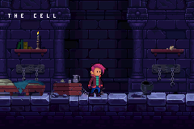
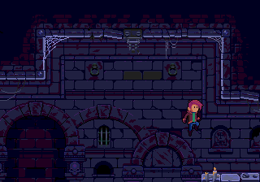
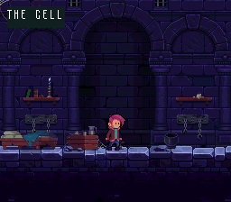

# Deceptus Console

**A C90 platformer engine for the Game Boy Advance, Super Nintendo, Mega Drive and Amiga 500,
with the modern content workflow of the [Deceptus engine](https://github.com/varnholt/deceptus_engine).**

[](https://github.com/varnholt/deceptus-console/actions/workflows/build-gba.yml)

Levels are drawn in Tiled and artwork stays at its original pixel size. One portable C engine
runs the game rules on every machine, and Python converters turn the same source content into
cartridges and disk images. The Deceptus opening, 26 rooms from the prison cells to the sword, is
the reference game: it plays through on all four systems.

| Game Boy Advance | Mega Drive | Super Nintendo |
| :---: | :---: | :---: |
|  |  |  |
| 59 fps, full speed | 6 fps, 20% speed | 2 fps, 7% speed |

The clips are real-time emulator recordings (mGBA, Genesis Plus GX, Snes9x) of the same climb
through the Crossroads, played from New Game with the recorded verification route. They are not
sped up: the Mega Drive and SNES renderers still need their performance pass, which is why the
same five seconds of game take 23 and 61 seconds there. The Amiga 500 runs this room at about
20 fps and full game speed; its clip follows.

## Why this engine

- **Author once, ship to four machines.** Rooms, collision, mechanisms, enemies and dialogue come
  from the same Tiled maps and Lua-described rules as the desktop engine. Converters keep every
  pixel and choose per-platform encodings (tiles, bitplanes, sprites) automatically.
- **Plain, portable C90 game code.** Fixed-point simulation at 60 ticks per second with bounded
  queues and no allocation, shared by every backend. Platform code only draws, reads input and
  streams memory.
- **Platform specialisations stay in platform tooling.** When a machine needs a cheaper version
  of something, the platform converter derives it from the shared source, so changing the game in
  one place still reaches every target. Example: the Amiga holds frames of the sword's shield
  ring that other systems animate every frame.
- **Verified, not assumed.** Every backend replays the same 56-checkpoint normal-input route
  against the native C simulation, and documentation records measured frame rates and memory.
- **Builds from one checkout.** Launchers fetch emulators and SDKs; GitHub Actions builds a GBA
  cartridge on every push.

## Platforms

| System | Hardware target | Opening | Crossroads clip |
| --- | --- | --- | --- |
| Game Boy Advance | 16.78 MHz ARM7, 288 KiB RAM | Complete route, full speed | 59 fps |
| Amiga 500 | 7.09 MHz 68000, OCS, 512 KiB Chip + 512 KiB slow RAM, Kickstart 1.3 | Complete route, 32 fps averaged over all rooms | about 20 fps, full speed |
| Mega Drive | 7.67 MHz 68000, 64 KiB RAM, 4 MiB cartridge | Complete route, experimental speed | 6 fps |
| Super Nintendo | 3.58 MHz 65816, 128 KiB RAM, 8 MiB ExHiROM | Complete route, experimental speed | 2 fps |

All four keep the game's 60 Hz simulation when a frame runs late, up to a per-platform limit
([simulation timing](docs/ARCHITECTURE.md#simulation-timing)). Audio, save games and the game
beyond the opening are not implemented yet; see [status](docs/STATUS.md) and
[parity with the original](docs/PARITY.md).

## Quick start

On Windows x64 with Python 3.13 (and LLVM for GBA builds), from the repository root:

```powershell
python run_gba.py                           # Game Boy Advance
python run_smd.py                           # Mega Drive
python run_snes.py                          # Super Nintendo
python run_amiga.py --scene tutorial --build   # Amiga 500 (WinUAE)
```

Each launcher downloads its missing emulator and SDK into `.tools/`, builds a missing cartridge
and opens it. `--build` rebuilds first. The cartridges also run in standalone emulators;
physical hardware has not been verified yet. Details, prerequisites and the
verification commands are in [building and testing](docs/BUILDING.md).

## Controls

| Project player keyboard | GBA input | Tutorial action |
| --- | --- | --- |
| Left / Right | D-pad | Move |
| Z / Space | A | Jump; confirm a dialogue or menu item |
| X | B | Jump during play; go back in menus |
| Up | Up | Interact |
| Down | Down | Bend down; crawling requires its separate skill |
| Down + Z | Down + A | Drop through a one-way floor |
| Enter | Start | Open pause menu; confirm a menu selection |
| Tab / R | Select | Inventory |
| C / Q / E | L / R | Swing the acquired sword |

Use Up/Down to browse owned inventory items. Up at the matching object uses a
key, seal or the rubies. Sword attacks require a fresh shoulder-button press.

The older four-area preview and SNES prototype use Select to restart instead
of opening inventory. A wall jump needs a fresh jump press while touching a wall.
State is held in RAM. Closing the emulator loses progression; save storage and
audio playback are not implemented yet.

## Current development build

The tutorial uses the original Deceptum bitmap font at its authored 13px size.
Large headings are exact 2x pixel copies, not newly rasterized 24px glyphs.
The opening also includes:

- Original ground-patrol blob, including its animated movement, contact damage and stomp death.
- Basic swimming using source atmosphere tiles, original swim sprites and a delayed A-button ascent.
- Original animated shrine column and a one-shot splash only when falling into water.
- Small water-exit hop, underwater colour tint and the original upward wind/wetsuit warning.
- New Game, Options and Quit; pause, controls, inventory and quit confirmation.
- Native-size dialogue windows, paged source text and animated interaction cues.
- The key, locker, lever handle and missing-handle rules, plus persistent flags
  and mechanism state when returning to a room.
- The Reading Room solar seal, Fool's Ledge headtorch chest, dark Sealed Cells,
  graveyard owl rubies, sinkhole/crypt return and delayed sword-cage release.
- Equipped sword artwork and basic source-timed attacks against supported blobs.
- Original room entrance rectangles, including Crossroads to Fool's Ledge and Main Hall to Mines Antechamber.
- Original one-way floor decoration and player occlusion by foreground artwork.
- Streamed room graphics and offline baked water surfaces; the player remains
  visible underwater. Complete water/progression fidelity remains unfinished.

See [current status](docs/STATUS.md) for verified coverage and open work. Imported
rooms and working isolated actions do not establish a complete playable route.

## Documentation

| Guide | Contents |
| --- | --- |
| [Building and testing](docs/BUILDING.md) | Prerequisites, builds, emulator checks, CI artifacts |
| [Architecture](docs/ARCHITECTURE.md) | Engine, game and backend boundaries; simulation timing; memory ownership |
| [Content pipeline](docs/CONTENT_PIPELINE.md) | From Tiled maps and source artwork to per-platform resources |
| [Status](docs/STATUS.md) | What works, what was measured, what remains |
| [Parity with the original](docs/PARITY.md) | Feature and documentation coverage against the Deceptus engine |
| Platform guides | [GBA](GBA.md), [SNES](docs/SNES.md), [Mega Drive](docs/MEGA_DRIVE.md), [Amiga 500](docs/AMIGA.md) |
| Mechanics | [Ropes](docs/ROPE.md), [sword](docs/SWORD.md), [projectiles](docs/PROJECTILES.md), [enemies](docs/SEALED_ENEMIES.md) |
| [Porting notes](PORTING.md) | Source inventory and the full-game strategy |

## Recording the clips

```powershell
python tools/capture_showcase.py gba --first-step 27 --last-step 52 --output docs/media/gba.gif
```

`capture_showcase.py` plays the verification route on an ordinary build and keeps every second
display frame, so each clip shows the platform's real frame rate. Use `smd` or `snes` for the
other cartridges.

## Ownership

Original code in this repository is covered by [LICENSE](LICENSE). Deceptus
content retains the terms in [the bundled data notice](assets/game/data/LICENSE.md)
and [game-content terms](assets/game/LICENSES/GAME-CONTENT.txt); artwork remains
credited to dstar. Dependencies
retain their upstream terms. Generated ROMs contain game content and are not
covered solely by this repository's code license.
